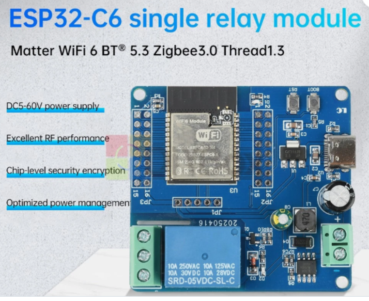
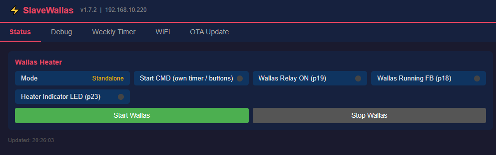
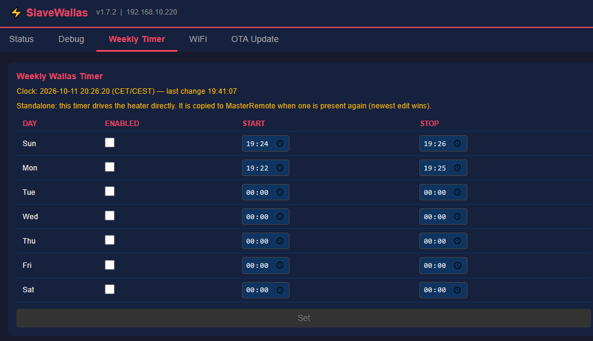

# RemoteStart — Honda EU70IS & Wallas Heater Remote Start

ESP32-based wireless remote start system for a Honda EU70IS generator and Wallas diesel heater, controlled via a Victron Venus relay, manual switches, or the web UI.

## Units

| Unit         | MCU      | Purpose                                   | Web UI tabs |
|--------------|----------|--------------------------------------------|-------------|
| MasterRemote  | ESP32    | Master — relay/button input, ESP-NOW hub  | Pin Status, Debug (incl. Manual GPIO Test), Nodes, Weekly Timer, WiFi, OTA Update |
| SlaveHonda   | ESP32    | Honda generator control (WiFi-preferred, ESP-NOW fallback) | Status, Debug, WiFi, OTA Update |
| SlaveWallas  | ESP32-C6 | Wallas heater control (WiFi required); also runs standalone | Status (incl. Start/Stop), Debug, Weekly Timer, WiFi, OTA Update |
| ESPNowRelay  | ESP32-C6 | Optional ESP-NOW store-and-forward repeater (see FSD §13) | Status (traffic/peers), Debug, WiFi, OTA Update |

## Framework

**ESP-IDF v6.0.1** (native C, CMake, FreeRTOS). No Arduino framework — WiFi, HTTP server, OTA, and the config portal are all built directly on ESP-IDF components. One managed component, `espressif/cjson` (cJSON, pulled via `idf_component.yml` since ESP-IDF v6 moved it out of the in-tree component set), is used for the GitHub Releases OTA feature.

## Features

- **ESP-NOW** peer-to-peer communication between units — no router hop needed for control traffic
- **Dynamic peer discovery** — each unit uses its own factory MAC and self-registers by function role over a broadcast beacon; no hardcoded peer table (see FSD §3.2)
- **SlaveHonda WiFi-optional fallback** — if it can't reach the router, it scans ESP-NOW channels for MasterRemote directly and keeps operating without an IP
- **ESPNowRelay repeater** (optional) — a transparent store-and-forward proxy that extends radio reach between MasterRemote and a far slave, with zero firmware changes on the other units; live traffic counters (count, sender, receiver, RSSI, last seen) on its own web UI (see FSD §13)
- **Native captive portal** — first-startup WiFi setup with network scan, served by `esp_http_server` directly
- **Web UI per unit** — live pin status, node roster with per-link RSSI/channel (MasterRemote), manual start/stop override, OTA update
- **NTP clock & weekly Wallas timer** (MasterRemote) — SNTP-synced CET/CEST clock; per-day enable with start/stop `HH:MM` window, OR'd in as a Wallas start source alongside the Victron relay, physical manual switch, and web override (see FSD §6.1a)
- **OTA firmware updates** — upload a `.bin` via the browser, no USB cable needed after the first flash; alternatively, the device can browse and install directly from this repo's GitHub Releases with a live progress bar, no manual download needed, plus a **Go GitHub** link straight to the repo (see FSD §7.2, v1.45/v1.48). The release listing is parsed as it streams in rather than buffered whole, so it stays within heap no matter how many releases accumulate, and the LWIP socket pool leaves room for the device's own outbound connection even with a browser parked on a polling tab (see FSD §12, v1.48)
- **Individual versioning** — each unit has its own `FIRMWARE_VERSION` in `main/version.h`
- **Resilient WiFi reconnection** — once a unit has connected once since boot, it retries indefinitely on any later disconnect instead of giving up after a few tries (fixed in v1.25 after a shared WiFi hiccup killed all three units' web servers until a manual power cycle; see FSD §10/§12)
- **System resource monitor** — free heap, heap low-water mark, uptime, and WiFi reconnect count on every unit's own web UI (`/api/sysinfo`), for catching a slow resource leak before it causes an outage (see FSD §10)
- **WiFi power save disabled, max TX power** — all three units run with `WIFI_PS_NONE` and max TX power instead of ESP-IDF's default modem-sleep, since the DTIM-interval wake latency that power save trades for battery life meaningfully hurts HTTP responsiveness at marginal signal strength, and these units aren't battery-constrained (see FSD §10, v1.32)
- **WiFi tab (DHCP or static IP)** — every unit's web UI now has an always-accessible WiFi tab: change SSID/password without reopening the config portal, and optionally switch from DHCP to a static IP/subnet/gateway/DNS (switching to Static pre-fills the current live values as a starting suggestion). Defaults to DHCP; saving either setting reboots the unit to apply. The tab also has a manual **Reboot Now** button (see FSD §4, v1.37/v1.38)
- **WiFi tab states what the unit is actually on** — the configured SSID and the AP it's currently associated to (shown separately, so "credentials fine but off the air" is distinguishable from "wrong credentials"), plus the live address source (static vs DHCP), IP, mask, gateway and DNS read back from the interface itself rather than from the saved config — so the IP is reported the same way whether it was configured here or handed out by the router (see FSD §4/§6, v1.47)
- **SlaveWallas runs standalone** — with no MasterRemote heard for 30 s, SlaveWallas drives the heater from its own **Start/Stop** buttons (Status tab) and its own **Weekly Timer** tab. With MasterRemote present it follows MasterRemote as before, its buttons act exactly like MasterRemote's own, and the two weekly timers are kept in sync over ESP-NOW (newest edit wins, also through ESPNowRelay). Both Weekly Timer tabs refresh themselves when the other unit changes the table, without overwriting unsaved edits (see FSD §3.5, v1.56)
- **Input Sources (MasterRemote)** — each physical input (Honda/Wallas Victron relay, Honda/Wallas manual switch) can be unticked on the Debug tab so an unwired input never starts anything; all enabled by default. The Victron inputs also have internal pull-ups now, so with the interface board absent they read idle instead of "start" (see FSD §2.2, v1.55)
- **Standardized Debug tab** — every unit now has a Debug tab (renamed from "Debug GPIO" on the slaves, newly added on MasterRemote/ESPNowRelay) holding the WiFi Link (RSSI/channel) and System resource monitor cards, keeping the Status tab focused on operational state only (see FSD §6.1/§6.2/§13, v1.40)
- **ESP-NOW RSSI on the slaves' own UI** — SlaveHonda/SlaveWallas's Debug tab "Radio Link" card now shows the ESP-NOW RSSI/channel of the last frame heard from MasterRemote, alongside the existing WiFi AP RSSI/channel — previously only visible remotely via MasterRemote's Nodes tab (see FSD §6.2, v1.41)
- **MAC addresses visible on every unit's own Radio Link card** — each unit now shows its own STA MAC address; the slaves also show MasterRemote's MAC, and ESPNowRelay's Radio Link card (renamed from "WiFi Link") adds a per-peer ESP-NOW RSSI + MAC summary (MasterRemote/SlaveHonda/SlaveWallas) — previously MAC addresses were only visible remotely (MasterRemote's Nodes tab, ESPNowRelay's Peers table), never on a unit's own page (see FSD §6.1/§6.2/§13, v1.42)

## Screenshots — SlaveWallas

<a href="docs/hardware/SlaveWallas_ESP32-C6_relay_module.png"></a>

**The board:** SlaveWallas runs on an ESP32-C6 single-relay module (DC 5–60 V supply, relay on
GPIO19) — see [Hardware Guide §3.2](docs/HARDWARE.md). Seller's product photo; click to enlarge.

**Status tab, running standalone** (no MasterRemote heard for 30 s): the Mode line says
*Standalone*, and **Start Wallas / Stop Wallas** drive the heater relay directly. With MasterRemote
present the same buttons act as MasterRemote's own (FSD §3.5).



**Weekly Timer tab:** the same 7-day table as MasterRemote's, kept in sync with it (newest edit
wins). The line under the clock says whether this table is driving the heater (standalone) or
MasterRemote is; the clock line also shows when the table last changed.



On the Wallas M26 installation, *Wallas Running FB (p18)* has nothing connected — the heater's
control terminals have no running signal (Hardware Guide §3.2) — so that dot stays off.

## First Startup

1. Power on the unit (a freshly flashed board starts here automatically — see [Build & Flash](#build--flash)).
2. Connect your phone or PC to its config WiFi, e.g. `SlaveWallas-Config`, password `honda1234`.
3. Open `http://192.168.4.1/wifi-setup` **in a normal browser tab** — not the phone's automatic "sign in to network" pop-up, which closes when the unit restarts.
4. Tap **Scan Networks**, pick your WiFi (or type it), enter the password, and press **Connect & Save**.
5. The unit restarts on your WiFi. Let your phone or PC rejoin your home WiFi and **leave the page open: it moves on to the unit by itself** — `http://slavewallas.local`, `http://masterremote.local`, `http://slavehonda.local` or `http://espnowrelay.local`.

If the page doesn't move on within a minute or two, open that `.local` address yourself. If that doesn't work either (an older Android phone, or a PC on a different subnet), look for the unit's name in your router's client list, or — for a slave — on MasterRemote's **Nodes** tab, which links each slave's IP. A fixed address can then be set on the unit's **WiFi** tab.

MasterRemote and SlaveWallas require WiFi. SlaveHonda prefers it but can operate WiFi-less over ESP-NOW.

## Build & Flash

### Flash a new unit from the browser (no toolchain)

Use the **[browser-based web flasher](https://sespe.github.io/RemoteStart/)**:
plug the board into whatever computer has the USB cable, open that page in
**Chrome or Edge** on desktop, and click the button for the unit you are
building — **Flash MasterRemote**, **Flash SlaveHonda**, **Flash SlaveWallas**
or **Flash ESPNowRelay**. No ESP-IDF or esptool install is needed on that
computer.

1. Plug in the board. ESP32 boards (MasterRemote, SlaveHonda) need the
   Silicon Labs CP210x driver; ESP32-C6 boards (SlaveWallas, ESPNowRelay)
   use native USB — hold **BOOT** while plugging in if no port appears.
2. Click the unit's button and pick its serial port.
3. Choose **Erase device** when offered. A board that ran other firmware
   before can otherwise keep stale data that leaves its radio silent.
4. When it reboots, do the WiFi setup as in [First Startup](#first-startup):
   join `<Unit>-Config` (password `honda1234`), open `http://192.168.4.1/wifi-setup`
   in a normal browser tab, scan, pick your WiFi and press **Connect & Save**.
   The page then takes you to the unit's own address by itself:

   | Unit | Address after setup |
   |------|---------------------|
   | MasterRemote | `http://masterremote.local` |
   | SlaveHonda | `http://slavehonda.local` |
   | SlaveWallas | `http://slavewallas.local` |
   | ESPNowRelay | `http://espnowrelay.local` |

   These `.local` names (mDNS) work from a phone or PC on the **same network/subnet** as the
   unit — Windows 10/11, macOS, iPhone, and Android roughly 12 and newer. Every unit also
   registers the same name with your router, so it shows up by name in the router's client list
   when `.local` doesn't work (older Android, or a PC on another subnet).

MasterRemote and SlaveHonda are both plain ESP32, so the flasher can't tell
which one you meant — make sure you press the right button. The C6 units are
checked: their firmware is refused on any other chip.

**If the flasher says "Failed to initialize":** the board didn't enter its download mode by
itself (some boards' auto-reset doesn't work). Hold **BOOT**, tap **EN/RST**, release **BOOT**,
then click the Flash button again. Afterwards press **EN/RST** once to start the new firmware.

**If the serial port is "busy" or "in use":** only one program can have it open. The flasher's
**Logs & console** view keeps it open while it's showing — close that dialog (or the tab)
before using esptool, `idf.py` or another serial monitor.

The page is for the initial flash only; every update after that goes over
OTA (below). It is rebuilt from `master` by
[`.github/workflows/webflash-pages.yml`](.github/workflows/webflash-pages.yml),
which builds all four units and publishes each one's bootloader, partition
table, OTA data and app image with an
[esp-web-tools](https://esphome.github.io/esp-web-tools/) manifest.

### Build and flash with ESP-IDF

```bash
# One-time ESP-IDF v6.0.1 environment setup (see FSD §11), then per unit:
cd MasterRemote            # or SlaveHonda / SlaveWallas / ESPNowRelay
idf.py set-target esp32c6 # SlaveWallas & ESPNowRelay only, first build
idf.py -p COMx erase-flash flash   # erase-flash: new or reused board only
```

## OTA Update

The OTA Update tab opens with a **Firmware Versions** table — for each unit, the newest version published on GitHub, the version stored in its inactive OTA slot (the previous image), and the version installed and running. An amber *Installed* box means GitHub has something newer. MasterRemote lists all four units in one table; the other units show themselves. ESPNowRelay isn't part of the ESP-NOW roster, so type its address once into the field under MasterRemote's table (remembered by your browser) to include it.

Manual upload:
1. `idf.py build`
2. Open the unit's page — `http://<unit>.local/` (e.g. `http://slavewallas.local/`) or its IP — → **OTA Update** tab
3. Upload `<Unit>/build/<Unit>.bin`

Or, from GitHub Releases (device needs internet access):
1. Open `http://<unit>.local/` (or the unit's IP) → **OTA Update** tab → **Install from GitHub Releases**
2. Click **Refresh Releases**, pick a release, click **Install Selected**
3. The device downloads and flashes it directly, then reboots

<a id="safety"></a>

## ⚠️ Safety and disclaimer

> [!CAUTION]
> This system starts a **fuel-burning heater** and a **generator** remotely and on a timer,
> possibly with nobody present. The wiring in the [hardware guide](docs/HARDWARE.md) describes
> **one** installation (an older Wallas M26 and a Honda EU70IS) and is **not verified for your
> equipment**. Before connecting SlaveWallas to a Wallas heater, read the precautions in
> [Hardware Guide §3](docs/HARDWARE.md#3-wallas-chain): check your heater's own documentation,
> measure the terminals, keep the heater's safety functions in charge, and test while present.
>
> **Use at your own risk.** Provided as is, without warranty of any kind. The authors accept no
> liability for any damage, injury, loss or fire arising from building, installing or using it.
> If in doubt, have a qualified installer do or check the installation.

## Documentation

- [FSD_RemoteStart.md](FSD_RemoteStart.md) — full Functional Specification Document (behaviour, protocols, web UI, pin-level reference).
- [FSD_RemoteStart_CHANGELOG.md](FSD_RemoteStart_CHANGELOG.md) — the change record, one entry per version.
- [docs/HARDWARE.md](docs/HARDWARE.md) — hardware guide: MasterRemote's opto-isolated Victron Venus interface board, manual-switch and indicator wiring, terminal-block assignments, and the end-to-end Honda start flow through to the EU7000is remote connector. Source drawings are in [docs/hardware/](docs/hardware/).

## Author

SEspe

## License

[MIT](LICENSE) — free to use, copy, modify and share, provided **as is, without warranty**; see
also the [safety and disclaimer](#safety) section above.

Not covered by the MIT license, because they are not this project's own work: the Wallas wiring
drawing ([`docs/hardware/Wallas_connector_onoff_thermostat.png`](docs/hardware/Wallas_connector_onoff_thermostat.png),
from third-party documentation) and the relay-module product photo
([`docs/hardware/SlaveWallas_ESP32-C6_relay_module.png`](docs/hardware/SlaveWallas_ESP32-C6_relay_module.png),
from a seller's listing). They are included for reference only and remain their owners'.
