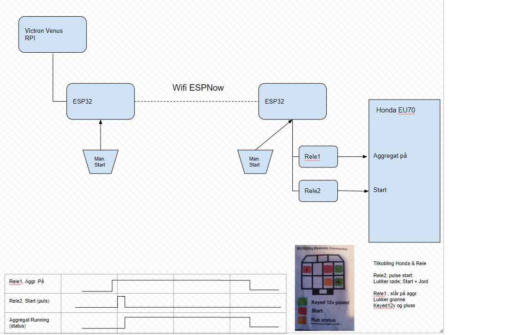
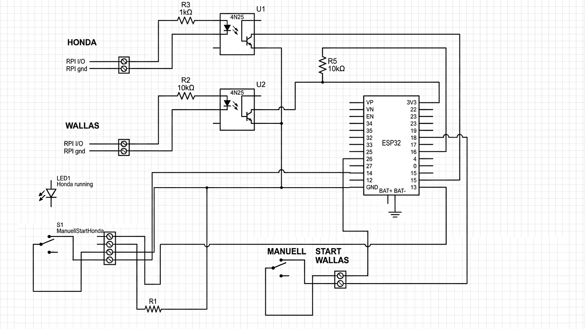

# Hardware Guide — RemoteStart

**Version:** 1.2 — 2026-10-11 (safety precautions and disclaimer for connecting SlaveWallas to a heater, §3)

This document covers the **physical/electrical** side of the system: what each unit is wired
to, how a start demand travels from the Victron Venus (Raspberry Pi) to the Honda EU7000is
remote connector and the Wallas heater relay, and what the signal polarities actually are on
the boards currently installed.

Firmware behaviour, protocols and the web UI are in [FSD_RemoteStart.md](../FSD_RemoteStart.md).
Where this guide and the FSD disagree about a pin, **this guide reflects a reading taken from
the live hardware** and the FSD is the one to correct.

> [!CAUTION]
> **Connecting anything here to a Wallas heater or a Honda generator is done at your own risk.**
> The wiring describes this one installation and is **not verified for your equipment**. Read the
> warning and disclaimer at the start of [§3](#3-wallas-chain) before wiring SlaveWallas to a heater.

## 0. Drawings

| File | What it is |
|------|------------|
| [`hardware/HondaStart_overall_flow.jpg`](hardware/HondaStart_overall_flow.jpg) | End-to-end Honda start flow: Venus → MasterRemote → ESP-NOW → SlaveHonda → Rele1/Rele2 → EU7000is. Includes the relay timing diagram and the EU7000is remote-connector legend. |
| [`hardware/MasterRemote_interface_schematic.png`](hardware/MasterRemote_interface_schematic.png) | Redrawn (clean) schematic of MasterRemote's interface board. **Has known transcription errors — see §6.** |
| [`hardware/MasterRemote_interface_schematic_marked.jpg`](hardware/MasterRemote_interface_schematic_marked.jpg) | Photo of the original hand-marked drawing. **Authoritative where the two disagree**: it identifies the module as a LOLIN32 Lite, corrects the Wallas LED resistor to 1 kΩ, and adds the second pull-up (R2). |
| [`hardware/Wallas_connector_onoff_thermostat.png`](hardware/Wallas_connector_onoff_thermostat.png) | The Wallas heater's 12 V control terminal block (1–6), with the two ways to control it from outside: simple on/off across terminals 4–5, or a changeover thermostat on 1–2–3. Norwegian notes; translated in §3.1. |
| [`hardware/SlaveWallas_ESP32-C6_relay_module.png`](hardware/SlaveWallas_ESP32-C6_relay_module.png) | Product photo of the planned SlaveWallas board: ESP32-C6 single-relay module, DC 5–60 V supply, Type-C, BOOT/RST buttons. §3.2. |

---

## 1. Overall flow — Honda start



```
Victron Venus (Raspberry Pi)
      │  relay/GPIO output, 12 V-referenced
      ▼
MasterRemote (ESP32, LOLIN32 Lite)      ← also: manual switch S1, web UI override
      │  opto-isolated input → GPIO15
      │
      │  ESP-NOW (2.4 GHz, no router hop; optionally via ESPNowRelay)
      ▼
SlaveHonda (ESP32)                      ← also: its own manual start input
      │
      ├── Rele1 ── "Aggregat på"  → EU7000is green pins  (Keyed 12 V + plus)
      └── Rele2 ── "Start (puls)" → EU7000is red pins    (Start + ground)
                                     EU7000is orange pin = Run status (output)
```

Both ends have an independent **Man. Start** input, so the generator can be started locally at
either box without the other end being alive. On MasterRemote that input is one of four OR'd
command sources (Victron relay, manual switch, web override, weekly timer — see FSD §6.1a);
setting any one of them asserts the start demand.

### 1.1 Relay functions and timing

| Signal | EU7000is pins | Behaviour | SlaveHonda pin |
|--------|---------------|-----------|----------------|
| **Rele1** — *Aggregat på* | closes the **green** pair (Keyed 12 V ↔ plus) | **maintained** — held closed for the whole run | GPIO14, ignition relay, active LOW |
| **Rele2** — *Start (puls)* | closes the **red** pair (Start ↔ ground) | **pulsed** — a short crank pulse only | GPIO13, starter relay, active LOW |
| **Run status** | **orange** pin (closed while the EU7000is is running) | generator output, read back | GPIO15, `PIN_RUNNING_FB` — **not wired on the current unit** (FSD §2.3) |

Sequence as implemented in `SlaveHonda/main/main.c` (`honda_start()`), matching the timing
diagram on the drawing:

1. **Ignition relay ON** (Rele1 closes) → 10 s warm-up (`HONDA_IGN_WARMUP_MS`)
2. **Starter relay ON** (Rele2 closes) → 3 s crank (`HONDA_CRANK_MS`)
3. **Starter relay OFF** → 1 s settle
4. Confirm running state — the drawing's third trace. **Currently taken from software state,
   not from the orange Run-status pin**, because that pin is unwired on this unit; see FSD
   §2.3/§12 for why the assumption is "started" rather than "not started".

Stop is the reverse and is abortable: a stop arriving during the warm-up or crank cancels the
sequence within ~100 ms rather than finishing the crank.

> The crank pulse is **not idempotent** — every start command spawns a full crank sequence.
> This is why MasterRemote gates re-sends on reported running state, and why a false
> "not running" reading once caused repeated re-cranking of a running engine (FSD v1.31).
> Keep this in mind before touching anything that resends a Honda start.

---

## 2. MasterRemote interface board



The module is a **LOLIN32 Lite (ESP32)**. Its header order — needed to read the drawing — is:

| Left header (top→bottom) | Right header (top→bottom) |
|--------------------------|----------------------------|
| VP, VN, EN, 34, 35, 32, 33, 25, 26, 27, **14**, 12, GND, (BAT+, BAT−) | **3V3**, 22, 19, 23, 18, **5**, 17, 16, **4**, 0, 2, **15**, **13** |

### 2.1 Components

| Ref | Part / value | Function |
|-----|--------------|----------|
| U1 | 4N25 optocoupler | Isolates the Venus **Honda** start output from the ESP32 |
| U2 | 4N25 optocoupler | Isolates the Venus **Wallas** start output from the ESP32 |
| R3 | 1 kΩ | Series resistor for U1's LED (Venus side) |
| R2 *(LED)* | **1 kΩ** | Series resistor for U2's LED. The clean redraw says 10 kΩ; the marked original corrects it to 1 kΩ — use 1 kΩ. |
| R2 *(pull-up)* | 10 kΩ | Pull-up from 3V3 to the **Honda** opto output (GPIO15). Only on the marked original. |
| R5 | 10 kΩ | Pull-up from 3V3 to the **Wallas** opto output (GPIO4) |
| R1 | 57 Ω | Series resistor for LED1 |
| LED1 | LED | "Honda running" panel indicator, driven from GPIO13 |
| S1 | SPDT toggle, *ManuellStartHonda* | Manual Honda start, wired via a 4-way screw terminal |
| — | SPDT toggle, *MANUELL START WALLAS* | Manual Wallas start, wired via a 2-way screw terminal |

Two `4N25` reference designators are reused for different parts in the two drawings (`R2` is
both the U2 LED resistor and the GPIO15 pull-up). Read `R2` from context, or from the marked
original where the handwriting distinguishes them.

### 2.2 Isolated inputs from the Victron Venus (Raspberry Pi)

Each Venus output drives an optocoupler LED through a 1 kΩ series resistor; the transistor side
is an open collector pulled up to the ESP32's own 3V3. **The two sides are galvanically
isolated** — the Venus and the ESP32 do not share a ground, which is the point of the 4N25s.

```
RPI I/O  ──[1 kΩ]──▶│ LED        collector ──┬── ESP32 GPIO
                     │  4N25                 │
RPI gnd  ────────────│            emitter  ──┴─[10 kΩ]── 3V3
                                              └────────── GND
```

Polarity, and this is the part that is easy to get backwards:

| Venus output | Opto LED | Transistor | ESP32 pin reads | Firmware sees |
|--------------|----------|------------|-----------------|---------------|
| **asserted** | lit | conducting | pulled **LOW** | start demanded |
| idle | dark | off | pull-up holds it **HIGH** | idle |

So both Victron inputs are **active LOW at the ESP32** and read inverted in firmware
(`!gpio_get_level(...)`), while being active *high* on the Venus side. R2/R5 are the pull-ups.
Since firmware 1.7.0 (FSD v1.55) the internal pull-ups on GPIO4/GPIO15 are **enabled** as well,
so that with this board absent or a wire broken the pin reads HIGH = idle instead of floating LOW,
which reads as a start demand. The opto still pulls the pin LOW easily against both.

> Verified live on 2026-08-10 (firmware 1.6.15, internal pull-ups then disabled) with the system
> idle: GPIO4 = 1 and GPIO15 = 1, which proved the external pull-ups are fitted. On 2026-10-11 a
> bare test board with nothing connected read GPIO4 = GPIO15 = 0 on 1.6.15 (both start commands
> on) and 1 on 1.7.0 (both idle).

### 2.3 Manual switches

Both manual switches are **maintained on/off toggles, not momentary buttons**, and both are
wired so that the **switch grounds its pin in the Off position** and releases it (internal
pull-up → HIGH) when switched On. Firmware therefore reads them **non-inverted**, with
`GPIO_PULLUP_ENABLE`.

> **Not fail-safe:** a broken wire or an unconnected switch reads the same as **On**. If a switch
> is not fitted, untick it under **Debug → Input Sources** (FSD §2.2). The wiring fix is to move
> each switch to its other contact (ground = On) and read it inverted.

| Switch | Terminal | ESP32 pin | Off | On |
|--------|----------|-----------|-----|-----|
| S1 *ManuellStartHonda* | 4-way block, screws 3+4 | GPIO14 | pin grounded → reads 0 | pin released → reads 1 |
| *MANUELL START WALLAS* | 2-way block | GPIO5 | pin grounded → reads 0 | pin released → reads 1 |

Each is one OR-source among several — On continuously demands start; Off simply stops
contributing, and another source (Victron, web, weekly timer) can still keep the appliance
running. Neither is a hard override.

> **Do not infer a pin's polarity from its neighbour.** GPIO4 (Victron, active LOW) and GPIO5
> (manual, active HIGH) sit on the same connector on the same board and use *opposite*
> conventions. Assuming otherwise produced a wrong-polarity build that was committed before
> being caught against a live reading (FSD v1.44). Always check `/api/status` or
> `/api/gpio/status` against the physical switch position before trusting an assumption.

### 2.4 Honda-running indicator

GPIO13 → 4-way terminal block → LED1 → R1 (57 Ω) → GND. MasterRemote drives it from the
running state reported by SlaveHonda over ESP-NOW, so it mirrors the generator, not the command.

GPIO13 is configured `GPIO_MODE_INPUT_OUTPUT` (not plain `OUTPUT`) so `gpio_get_level()` can
read the driven level back for the web UI's `pFB` field — a plain output pin reads 0 always on
ESP32. Any new output that needs a status readback must do the same (FSD v1.36).

### 2.5 Field wiring — terminal blocks

| Block | Screws | Goes to |
|-------|--------|---------|
| HONDA (2-way) | RPI I/O, RPI gnd | Venus Honda start output → R3 → U1 LED |
| WALLAS (2-way) | RPI I/O, RPI gnd | Venus Wallas start output → 1 kΩ → U2 LED |
| 4-way | 1, 2 | LED1 "Honda running" (GPIO13 / R1 → GND) |
| 4-way | 3, 4 | S1 manual Honda start (GPIO14 ↔ GND) |
| 2-way | 1, 2 | Manual Wallas start switch (GPIO5 ↔ GND) |

### 2.6 Pin map, with live readings

Taken from `GET /api/gpio/status` and `GET /api/status` on MasterRemote (192.168.1.100,
firmware 1.6.15) on **2026-08-10**, system fully idle:

| GPIO | Direction | Signal | Pull | Active | Idle level | API field |
|------|-----------|--------|------|--------|-----------|-----------|
| 2 | INPUT_OUTPUT | Onboard heartbeat LED | — | — | 1 | — |
| 4 | INPUT | Wallas start — Venus via U2 | external 10 kΩ (R5) + internal (1.7.0) | **LOW** | 1 | `pWS` = false |
| 5 | INPUT | Wallas manual switch | internal pull-up | **HIGH** | 0 | `pWM` = false |
| 13 | INPUT_OUTPUT | Honda-running LED (LED1) | — | HIGH = lit | 0 | `pFB` = false |
| 14 | INPUT | Honda manual switch (S1) | internal pull-up | **HIGH** | 0 | `pHM` = false |
| 15 | INPUT | Honda start — Venus via U1 | external 10 kΩ (R2) + internal (1.7.0) | **LOW** | 1 | `pHS` = false |

All four inputs carry `GPIO_INTR_ANYEDGE` interrupts. Both ISRs recompute their command from
**every** OR-source, never a subset — see FSD §12 for why (this bug class has appeared three
times).

---

## 3. Wallas chain

> [!CAUTION]
> ## ⚠️ READ THIS BEFORE CONNECTING SLAVEWALLAS TO A WALLAS HEATER ⚠️
>
> **A Wallas heater is a fuel-burning appliance.** Starting it remotely, or at the wrong time,
> can cause **fire, carbon-monoxide poisoning, damage to the heater, or a flat battery** — on a
> boat or caravan, possibly with nobody aboard.
>
> **The wiring in §3.1–3.2 is NOT verified for your heater.** It describes *one* installation:
> an **older Wallas M26**, worked out from a third-party wiring drawing for a different
> controller ("A2" unit), not from Wallas documentation. Your heater may be a different model
> or revision, may have been modified, or may use the same terminal numbers for something else.
>
> **Before you connect anything, check that it is acceptable to do it as described:**
>
> 1. **Get the documentation for your own heater** — the Wallas installation manual for your
>    model, or ask a Wallas dealer / qualified installer — and confirm that joining terminals
>    **4 and 5** is a permitted way to start it, and that terminal 5 may supply a small external
>    load (the relay board, about 1 W).
> 2. **Measure it.** With a multimeter, confirm terminal 6 is 12 V negative, terminal 5 is +12 V
>    to it, and that 5 is live with the heater off. Do not rely on wire colours or on this guide.
> 3. **Make sure the heater's own safety functions stay in charge** — overheat cut-out, flame
>    monitoring, ventilation and exhaust. This system only replaces a manual on/off switch; it must
>    never bypass or override anything the heater does to protect itself.
> 4. **Fuse the feed** to the relay board, use **≥ 0.7 mm²** wire on terminals 4–5, and use the
>    relay's **NO** contact, so a failed or unpowered board leaves the heater **off**.
> 5. **Test on the bench first** (USB power, nothing on the relay), then **test at the heater
>    while you are present**: start, stop, MasterRemote unplugged (standalone), power cut. Watch
>    that the heater stops every time it should.
> 6. **Remote and timer starts happen when nobody is watching.** Only use them if the heater is
>    installed so that it is safe to run unattended, per its manual and local rules.
>
> If any of this cannot be confirmed — **do not connect it.**
>
> **DISCLAIMER — USE AT YOUR OWN RISK.** This project, its firmware and this documentation are
> provided **as is, without any warranty** of any kind, including fitness for a particular
> purpose. Connecting SlaveWallas (or any part of this system) to a heater, generator or other
> equipment is done **entirely at your own risk and responsibility**. The authors and
> contributors accept **no liability** for any damage, injury, loss, fire, voided warranty or
> insurance consequence arising from building, installing or using it. If in doubt, have the
> installation done or checked by a qualified installer.

Same front end, different back end: MasterRemote's `g_wallas_start_cmd` is sent over ESP-NOW to
**SlaveWallas** (ESP32-C6), which drives a single relay.

| SlaveWallas GPIO | Direction | Signal |
|------|-----------|--------|
| 19 | INPUT_OUTPUT | Wallas heater relay — **HIGH = heater ON** (not inverted, unlike SlaveHonda's relays) |
| 23 | INPUT_OUTPUT | Heater indicator LED, mirrors the relay |
| 18 | INPUT | Running feedback, HIGH = running |
| 2 | INPUT_OUTPUT | Onboard LED |

Unlike the Honda crank, a **Wallas command is idempotent** — it is a plain relay level, so
resending it is harmless. MasterRemote therefore just resends every 15 s rather than gating on
feedback.

> **GPIO12/13 on the ESP32-C6 are the native USB-Serial/JTAG D−/D+ pads.** Do not use them as
> GPIO on SlaveWallas or ESPNowRelay; doing so breaks console/flash access at runtime.

SlaveWallas also runs on its own when MasterRemote is absent (own Start/Stop and weekly timer,
FSD §3.5). The wiring below is the same either way.

### 3.1 Wallas heater control terminals

The installed heater is an **older Wallas M26** burner/heater. It has a six-way 12 V control terminal block
([drawing](hardware/Wallas_connector_onoff_thermostat.png)):

| Terminal | Function |
|----------|----------|
| 6 | − supply (12 V negative) |
| 5 | + supply (12 V positive) |
| 4 | Start input: **connected to 5 = heater on, open = heater off** |
| 1, 2, 3 | Changeover-thermostat input (not used here) |

The drawing's notes, translated:

- **Simple on/off control:** use relay 1 on the controller. Wallas only knows open = heater off,
  closed = heater on. Connect terminals **4 and 5** to the relay terminals; which way round does
  not matter, it is a plain switch.
- **Use at least 0.7 mm² wire** for the connection. Telephone or data cable is not good enough:
  a little current flows here, and a thin cable causes faults.
- *Thermostat control (not used):* a changeover thermostat on terminals 1–2–3, switching 1 to
  either 3 or 4. When the set temperature is reached the heater drops to minimum, and goes back up
  to the level set on the heater's own knob when the temperature falls.

### 3.2 SlaveWallas board and wiring

> [!WARNING]
> **Unverified for your heater — read the precautions and disclaimer at the start of §3 first.**
> Check your own heater's documentation and measure before connecting. At your own risk.

Planned board: an **ESP32-C6 single-relay module**
([photo](hardware/SlaveWallas_ESP32-C6_relay_module.png)) — DC 5–60 V supply terminal, Type-C
USB, BOOT and RST buttons, one SRD-05VDC-SL-C relay with COM/NO/NC terminals (rated 10 A at
30 V DC, far above the start input's needs). It replaces the current SlaveWallas board and runs
the same firmware.

| Wallas terminal | Wire to | Notes |
|-----------------|---------|-------|
| 6 (−) | Module supply **−** | |
| 5 (+12 V) | Module supply **+** | The module takes 5–60 V, so it runs straight off the heater's 12 V |
| 5 (+12 V) | Relay **COM** | Second wire from terminal 5, or a jumper from the supply + terminal |
| 4 | Relay **NO** | Relay energised → 4 joined to 5 → heater on |

- **NO, not NC:** with NO, a dead or unpowered SlaveWallas leaves the heater **off**. NC would
  run the heater whenever the board is unpowered or rebooting.
- Wire 4 and 5 with **≥ 0.7 mm²** (§3.1).
- Terminal 5 has to be live while the heater is off, since joining 4 to 5 is what starts it. So
  the module stays powered and reachable with the heater off.
- There is **no running-feedback signal** on this connector. GPIO18 (running feedback) stays
  unconnected; the firmware's `run` field is not meaningful on this installation.
- **Relay GPIO: not yet known.** The board's pinout is not published. The current firmware drives
  GPIO19. To find the real pin: flash SlaveWallas from the browser flasher (hold BOOT while
  plugging in if no port appears), open **Debug → Manual GPIO Test** and press ON/OFF pin by pin
  until the relay clicks; note the onboard LED's pin the same way. If it is not GPIO19 the
  firmware needs a board setting before the module is installed.
- Bench-test on USB power first (relay COM/NO left unconnected), then move to the heater's 12 V.

---

## 4. SlaveHonda

| GPIO | Direction | Signal |
|------|-----------|--------|
| 13 | INPUT_OUTPUT | Starter relay — **active LOW** = crank ON → EU7000is red pair (Rele2) |
| 14 | INPUT_OUTPUT | Ignition relay — **active LOW** = ignition ON → EU7000is green pair (Rele1) |
| 15 | INPUT | Running feedback, LOW = running → EU7000is orange pin. **Not wired on the current unit.** |
| 4 | INPUT_OUTPUT | External status LED |
| 2 | INPUT_OUTPUT | Onboard LED (fast blink = start commanded, slow = idle) |

When GPIO15 is eventually wired to the EU7000is Run-status pin, **two hardcoded sites in
`honda_start()`/`send_status()` must be reverted** to `!gpio_get_level(PIN_RUNNING_FB)` — the
code comments mark both. Until then the running state is a software assumption (FSD §2.3/v1.31).

---

## 5. Power and placement

- All units are mains/battery-bank powered, not battery-constrained. WiFi modem-sleep is
  therefore disabled (`WIFI_PS_NONE`) and TX power set to max, because the DTIM wake latency
  measurably hurt HTTP responsiveness (FSD v1.32).
- MasterRemote and SlaveWallas are in/near the house; **SlaveHonda is out in the shed by the
  generator**, at the edge of router range (RSSI around −87 dBm). It is WiFi-preferred with an
  ESP-NOW channel-scan fallback so it keeps working with no IP at all.
- **ESPNowRelay** is an optional 4th unit placed between the two, a transparent store-and-forward
  ESP-NOW repeater. It has no I/O of its own beyond GPIO2 (onboard LED: fast blink = traffic
  forwarded in the last 10 s). See FSD §13.

---

## 6. Known errors in the redrawn schematic

The clean PNG was transcribed from the hand-marked original and picked up several errors. They
are **drawing errors only** — the built hardware and the firmware agree with each other, as the
live readings in §2.6 confirm.

1. **Right-header pin labels are wrong.** The PNG lists `3V3, 22, 23, 23, 19, 18, 17, 16, 4, 0,
   15, 15, 13` — with `23` and `15` each duplicated and `5` and `2` missing. The real LOLIN32
   Lite order is `3V3, 22, 19, 23, 18, 5, 17, 16, 4, 0, 2, 15, 13` (§2). Every row from the 3rd
   down is shifted, which is why the Wallas opto appears to land on GPIO16 in the PNG when it is
   really **GPIO4** one row below.
2. **The Wallas opto's collector is drawn on the 3V3 node** instead of on the R5/GPIO4 node.
   As drawn, U2 would short 3V3 to ground when active and GPIO4 would never move. The working
   circuit is: 3V3 → R5 → GPIO4 → U2 collector, U2 emitter → GND.
3. **U2's LED resistor is drawn as 10 kΩ.** The marked original corrects it to 1 kΩ, matching
   U1's R3.
4. **The GPIO15 pull-up is missing entirely from the PNG.** It is on the marked original as
   `R2, 10K`, and its presence is confirmed by GPIO15 reading HIGH at idle with its internal
   pull-up disabled.
5. **LED1 is drawn unconnected.** It is wired to screws 1–2 of the 4-way terminal block
   (GPIO13 / R1 → GND).

Fixing the redraw is worth doing before anyone wires a replacement board from it. Until then,
**wire from the marked original photo, not the PNG.**

---

## 7. If a board is ever replaced

Hardware facts in this document are properties of the **specific physical units currently
installed**, not of the design. Both MasterRemote and SlaveHonda were swapped for new boards on
2026-07-02, and the replacement MasterRemote's Wallas wiring polarity came out **opposite** to
the old one's. So, on any swap:

1. `idf.py erase-flash` before the first flash if the board has any unknown prior firmware —
   a plain `flash` leaves stale RF/PHY calibration data behind and the radio can come up
   silently dead while every log line still reports success.
2. Re-verify **every** input polarity against the physical switch/relay position using
   `/api/gpio/status` and `/api/status` before trusting the firmware's inversions.
3. Note the new factory MAC. No re-pairing is needed — units self-register by role over the
   discovery beacon and re-home to a new peer MAC after the 30 s staleness timeout.
4. Any new output that appears in a status field must be configured `GPIO_MODE_INPUT_OUTPUT`.
